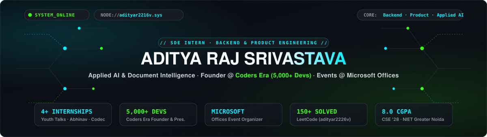

<div align="center">

  <!-- Interactive High-Tech Vector Banner -->
  

  <br/><br/>

  <!-- Dynamic Typing Animation Header -->
  

  <br/><br/>

  <!-- Direct Contact & Profile Badges -->
  <p align="center">
    <a href="https://linkedin.com/in/aditya-raj-srivastava-401b75328" target="_blank">
      
    </a>
    &nbsp;
    <a href="mailto:srivastavaadityaraj751@gmail.com" target="_blank">
      
    </a>
    &nbsp;
    <a href="./Aditya_Raj_Srivastava_ASS.pdf" target="_blank">
      
    </a>
    &nbsp;
    <a href="https://github.com/adityar2216v?tab=repositories" target="_blank">
      
    </a>
  </p>

</div>

---

### ⚡ System Telemetry & Key Impact Metrics

```yaml
architect:      Aditya Raj Srivastava
system_status:  ONLINE // Open for High-Impact Engineering Roles & Collaborations
architecture:   Distributed Microservices · Generative AI · Event-Driven Architecture
location:       Gautam Buddha Nagar, India (UTC +05:30)
credentials:    B.Tech in CSE (2024-2028) @ NIET Greater Noida (AKTU) · 8.0 CGPA
```

<table align="center" width="100%">
  <tr>
    <td align="center" width="16%">
      <b>🚀 6 Systems</b><br/>
      <sub>Production Deployed</sub>
    </td>
    <td align="center" width="16%">
      <b>🧠 &lt; 200ms</b><br/>
      <sub>LLM Dialogue Latency</sub>
    </td>
    <td align="center" width="20%">
      <b>👥 5,000+ Devs</b><br/>
      <sub>Coders Era Founder</sub>
    </td>
    <td align="center" width="16%">
      <b>🛡️ Founding CTO</b><br/>
      <sub>Resiqra (EdTech DRS)</sub>
    </td>
    <td align="center" width="16%">
      <b>💻 150+ Solved</b><br/>
      <sub>LeetCode DSA (Java)</sub>
    </td>
    <td align="center" width="16%">
      <b>📉 40% Cut</b><br/>
      <sub>Pipeline Latency</sub>
    </td>
  </tr>
</table>

---

## 🧬 Engineering Mindset & Identity

> *"I bridge the gap between probabilistic AI reasoning and deterministic, low-latency software architecture. Rather than relying on simple wrappers, I build resilient end-to-end systems that scale under real-world traffic, eliminate manual bottlenecks, and deliver measurable business leverage."*

- 🏗️ **Distributed Full-Stack Systems:** Designing reactive frontend applications ([Next.js](https://nextjs.org), [React](https://react.dev), [TypeScript](https://www.typescriptlang.org)) coupled with high-throughput backend services ([Node.js](https://nodejs.org), [Flask](https://flask.palletsprojects.com), [PostgreSQL](https://www.postgresql.org), [Supabase](https://supabase.com)).
- 🧠 **Generative AI & LLM Pipelines:** Architecting production Retrieval-Augmented Generation (RAG) workflows, intelligent document intelligence modules, structured schema parsing, and sub-200ms dialogue inference.
- 👑 **Venture & Community Leadership:** 
  - **Founding CTO at Resiqra:** Leading technology architecture and engineering execution for an EdTech DRS platform delivering accredited disaster resilience and ethics coursework.
  - **Founder & President at Coders Era:** Scaled a thriving developer community to **5,000+ members**, delivering 10+ hands-on technical workshops and mentoring 100+ hackathon submissions as a Technical Judge.
- 🎯 **Algorithmic Rigor:** 150+ problems solved on LeetCode in **Java**, prioritizing robust Object-Oriented Design, time/space complexity optimization, and clean microservice patterns.
- 📈 **Quantified Impact:** Engineered pipelines that cut processing latency by **40%**, reduced downstream defects by **30%**, and eliminated **50%** of manual operational overhead.

---

## 🚀 Production Systems & Active Deployments

<table>
  <thead>
    <tr>
      <th align="left" width="24%">System</th>
      <th align="left" width="36%">Architecture & Purpose</th>
      <th align="left" width="24%">Stack</th>
      <th align="left" width="16%">Metrics & Links</th>
    </tr>
  </thead>
  <tbody>
    <tr>
      <td>
        <b><a href="https://ai-task-manager-seven.vercel.app" target="_blank">AI Task Manager</a></b><br/>
        <sub><code>Live Production</code> · <code>SaaS</code></sub>
      </td>
      <td>Autonomous task prioritization engine with dynamic priority scoring and structured execution workflows.</td>
      <td>
        
        
        
      </td>
      <td>
        <code>-35% Overhead</code><br/>
        <a href="https://ai-task-manager-seven.vercel.app" target="_blank">🌐 Live Demo</a> · <a href="https://github.com/adityar2216v/ai-task-manager" target="_blank">🐙 Repo</a>
      </td>
    </tr>
    <tr>
      <td>
        <b><a href="https://fintech-xi-nine.vercel.app" target="_blank">FinTech Doc Intelligence</a></b><br/>
        <sub><code>Live Production</code> · <code>AI Pipeline</code></sub>
      </td>
      <td>Intelligent processing pipeline converting unstructured financial documentation into validated JSON schemas.</td>
      <td>
        
        
        
      </td>
      <td>
        <code>90%+ Accuracy</code><br/>
        <a href="https://fintech-xi-nine.vercel.app" target="_blank">🌐 Live Demo</a> · <a href="https://github.com/adityar2216v/fintech" target="_blank">🐙 Repo</a>
      </td>
    </tr>
    <tr>
      <td>
        <b><a href="https://terrasense-flame.vercel.app" target="_blank">TerraSense</a></b><br/>
        <sub><code>Live Production</code> · <code>Analytics</code></sub>
      </td>
      <td>Geospatial and environmental telemetry dashboard delivering real-time environmental risk visualization.</td>
      <td>
        
        
        
      </td>
      <td>
        <code>Real-time Data</code><br/>
        <a href="https://terrasense-flame.vercel.app" target="_blank">🌐 Live Demo</a> · <a href="https://github.com/adityar2216v/terrasense" target="_blank">🐙 Repo</a>
      </td>
    </tr>
    <tr>
      <td>
        <b><a href="https://weather-nova-vert.vercel.app" target="_blank">WeatherNova</a></b><br/>
        <sub><code>Live Production</code> · <code>Real-Time Web</code></sub>
      </td>
      <td>High-speed meteorological forecasting application with responsive data-binding and weather metric visualization.</td>
      <td>
        
        
        
      </td>
      <td>
        <code>Low-latency API</code><br/>
        <a href="https://weather-nova-vert.vercel.app" target="_blank">🌐 Live Demo</a> · <a href="https://github.com/adityar2216v/weathernova" target="_blank">🐙 Repo</a>
      </td>
    </tr>
    <tr>
      <td>
        <b><a href="https://edtech-emark.vercel.app" target="_blank">E-Mark EdTech</a></b><br/>
        <sub><code>Live Production</code> · <code>Education</code></sub>
      </td>
      <td>Academic management and progress evaluation portal supporting automated performance grading workflows.</td>
      <td>
        
        
        
      </td>
      <td>
        <code>Zero Downtime</code><br/>
        <a href="https://edtech-emark.vercel.app" target="_blank">🌐 Live Demo</a> · <a href="https://github.com/adityar2216v/edtech-emark" target="_blank">🐙 Repo</a>
      </td>
    </tr>
    <tr>
      <td>
        <b><a href="https://github.com/adityar2216v/codersera-new-web" target="_blank">Coders Era Platform</a></b><br/>
        <sub><code>Live Production</code> · <code>Community</code></sub>
      </td>
      <td>Official tech portal coordinating hackathons, workshops, and resource distribution for 5,000+ developers.</td>
      <td>
        
        
        
      </td>
      <td>
        <code>5,000+ Users</code><br/>
        <a href="https://github.com/adityar2216v/codersera-new-web" target="_blank">🐙 Source Repo</a>
      </td>
    </tr>
  </tbody>
</table>

---

## 🛠️ Technical Arsenal & Core Competencies

<details open>
<summary><b>🔹 Core Programming Languages</b></summary>
<br>

<p align="left">
  
  
  
  
  
  
  
</p>
</details>

<details open>
<summary><b>🔹 Generative AI & Intelligent Systems</b></summary>
<br>

<p align="left">
  
  
  
  
  
  
</p>
</details>

<details open>
<summary><b>🔹 Frontend Engineering & Frameworks</b></summary>
<br>

<p align="left">
  
  
  
  
  
  
  
</p>
</details>

<details open>
<summary><b>🔹 Backend Services & Distributed Systems</b></summary>
<br>

<p align="left">
  
  
  
  
  
  
</p>
</details>

<details open>
<summary><b>🔹 Databases, Cloud & DevOps Infrastructure</b></summary>
<br>

<p align="left">
  
  
  
  
  
  
  
  
  
</p>
</details>

<details open>
<summary><b>🔹 CS Fundamentals & Problem Solving</b></summary>
<br>

<p align="left">
  
  
  
  
  
  
</p>
</details>

---

## 💼 Professional Experience & Engineering Impact

### 🔹 Developers Arena
**Python & Generative AI Development Intern** · *Aug 2025 – Nov 2025*
- **Modular Python Backend Architecture:** Engineered 3+ microservices applying OOP and Service-Oriented Architecture (SOA) patterns; integrated LLM-based reasoning pipelines that **reduced downstream processing defects by 30%**.
- **High-Reliability RESTful APIs:** Designed and deployed 5+ production REST endpoints consumed by React frontends; eliminated cross-service bottlenecks to **improve API reliability by 30%**.
- **Automated Data Processing Workflows:** Built intelligent automation pipelines, **reducing manual operational intervention by 40%** and boosting throughput across processing queues.
- **Agile Ownership:** Led the end-to-end delivery of an LLM-powered document intelligence module; coordinated an 8-person Agile engineering team with **100% on-time milestone delivery**.

### 🔹 YHills
**Web Development Intern** · *2024*
- **Enterprise ERP Modules:** Developed 3 SaaS ERP subsystems and an automated e-commerce web platform backed by dynamic MySQL schemas, **reducing manual data entry by 50%**.
- **Security & Authorization Framework:** Implemented JWT authentication and fine-grained Role-Based Access Control (RBAC), securing sensitive customer records for 100+ active users.

### 🔹 CodSoft
**Web Development Intern** · *2024*
- **Full-Stack Interface Delivery:** Developed responsive web platforms, portfolio architectures, and dynamic catalog workflows focusing on clean CSS token structures and fast DOM render speeds.

---

## 👑 Leadership & Venture Track

<table>
  <tr>
    <td width="50%" valign="top">
      <h3>🛡️ Founding CTO @ Resiqra</h3>
      <p><code>EdTech · Disaster Resilience</code> · <code>Core Tech Leadership</code></p>
      <ul>
        <li>Directing overall technical vision, system architecture, and engineering execution for the platform.</li>
        <li>Engineering an enterprise-grade learning DRS delivering accredited disaster management, ethics, and emergency resilience certifications from national & global institutions.</li>
        <li>Architecting scalable backend data pipelines, secure student credentialing, and resilient cloud infrastructure.</li>
      </ul>
    </td>
    <td width="50%" valign="top">
      <h3>👥 Founder & President @ Coders Era</h3>
      <p><code>5,000+ Engineers</code> · <code>Pan-India Tech Community</code></p>
      <ul>
        <li>Founded and scaled an active engineering community to <b>5,000+ developers</b> across colleges and tech teams.</li>
        <li>Delivered <b>10+ hands-on technical workshops</b> on Data Structures & Algorithms, Full-Stack Architecture, and Generative AI.</li>
        <li>Served as <b>Technical Judge & Hackathon Mentor</b> across 3+ multi-community national hackathons, reviewing 100+ algorithmic solutions and product architectures.</li>
      </ul>
    </td>
  </tr>
</table>

> **⭐ Amazon ML Summer School 2025:** Selected candidate for Amazon India's competitive machine learning curriculum taught directly by Amazon Research Scientists — covering Supervised Learning, Deep Learning, NLP, LLMs, and Multi-Agent Orchestration across 8 intensive modules.

---

## 🎓 Academic Training

```bash
[2024 - 2028]  BACHELOR OF TECHNOLOGY (B.TECH) - COMPUTER SCIENCE & ENGINEERING
               Noida Institute of Engineering and Technology (NIET, Greater Noida)
               Dr. A.P.J. Abdul Kalam Technical University (AKTU)
               
               • Cumulative GPA: 8.0 / 10.0
               • Core Coursework:
                 - Data Structures & Algorithms (DSA)
                 - Object-Oriented Programming (OOP in Java & C++)
                 - Database Management Systems (DBMS & Query Optimization)
                 - Operating Systems & Concurrency (Linux / Processes / Multi-threading)
                 - Computer Networks & Protocols (TCP/IP / HTTP / WebSockets)
                 - Discrete Mathematics & Theoretical Computation
```

---

## 📊 Telemetry Dashboard & Live Activity

<div align="center">

  <!-- Verified High-Reliability Stats Grid -->
  <table border="0" align="center">
    <tr>
      <td align="center">
        <a href="https://github.com/adityar2216v">
          
        </a>
      </td>
      <td align="center">
        <a href="https://github.com/adityar2216v">
          
        </a>
      </td>
    </tr>
    <tr>
      <td colspan="2" align="center">
        <a href="https://github.com/adityar2216v">
          
        </a>
      </td>
    </tr>
  </table>

  <br/>

  <!-- Verified Contribution Grid Snake Animation -->
  <p align="center">
    <b>🐍 Activity Matrix // Contribution Stream</b>
  </p>
  <picture>
    <source media="(prefers-color-scheme: dark)" srcset="https://raw.githubusercontent.com/adityar2216v/adityar2216v/output/github-contribution-grid-snake-dark.svg">
    <source media="(prefers-color-scheme: light)" srcset="https://raw.githubusercontent.com/adityar2216v/adityar2216v/output/github-contribution-grid-snake.svg">
    
  </picture>

</div>

---

## 📡 Connect & Dispatch Console

<table align="center" width="100%">
  <tr>
    <td align="center" width="25%">
      <a href="https://linkedin.com/in/aditya-raj-srivastava-401b75328" target="_blank">
        <br/>
        <sub><code>/in/aditya-raj-srivastava</code></sub>
      </a>
    </td>
    <td align="center" width="25%">
      <a href="mailto:srivastavaadityaraj751@gmail.com" target="_blank">
        <br/>
        <sub><code>srivastavaadityaraj751@gmail.com</code></sub>
      </a>
    </td>
    <td align="center" width="25%">
      <a href="./Aditya_Raj_Srivastava_ASS.pdf" target="_blank">
        <br/>
        <sub><code>Aditya_Raj_Srivastava_ASS.pdf</code></sub>
      </a>
    </td>
    <td align="center" width="25%">
      <a href="https://github.com/adityar2216v" target="_blank">
        <br/>
        <sub><code>github.com/adityar2216v</code></sub>
      </a>
    </td>
  </tr>
</table>

<br/>

<div align="center">
  <sub>Engineered &amp; Maintained with precision by <b>Aditya Raj Srivastava</b></sub>
</div>
